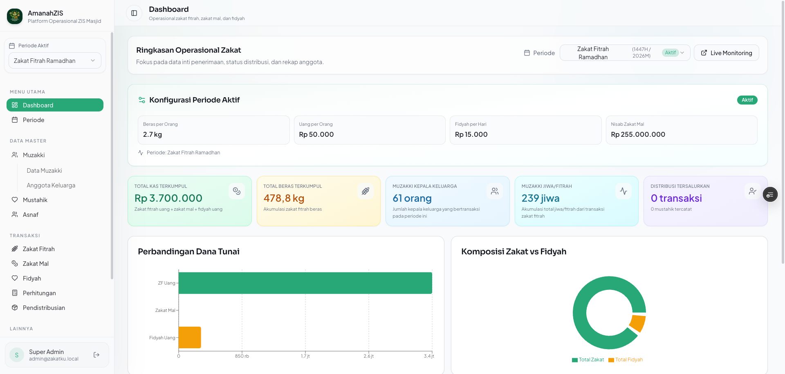
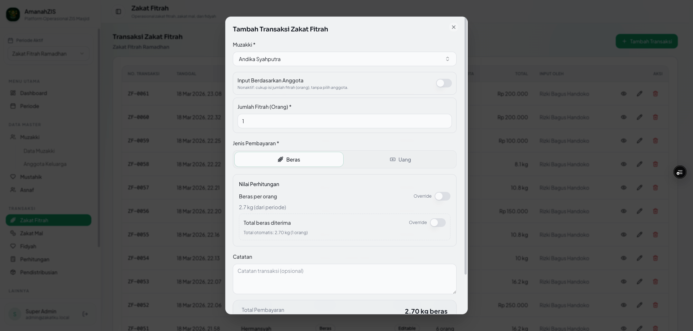
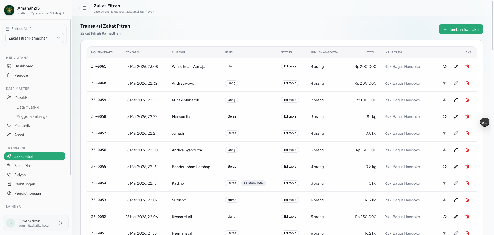
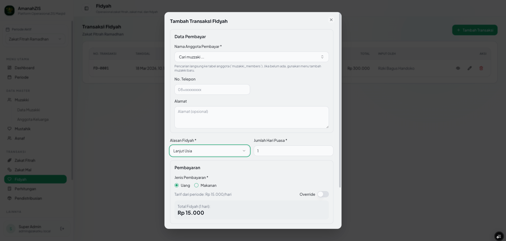
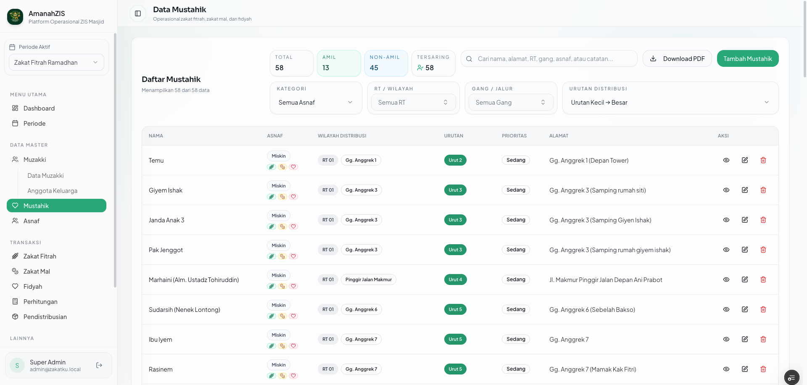
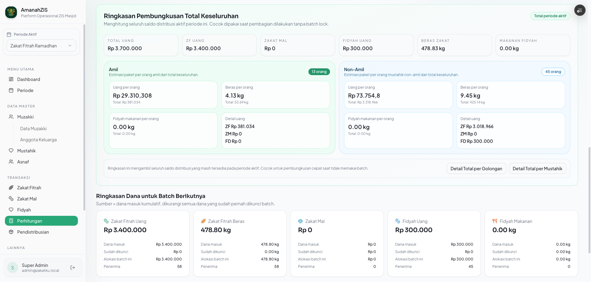
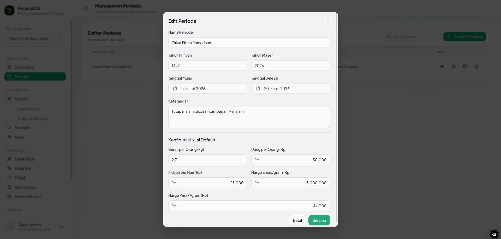
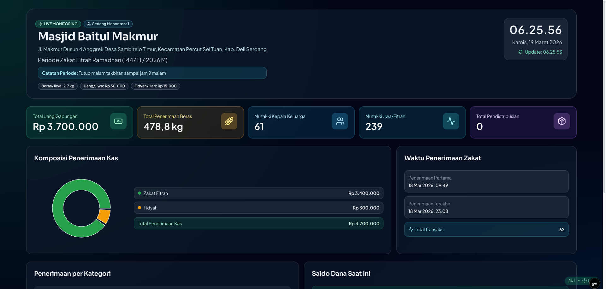
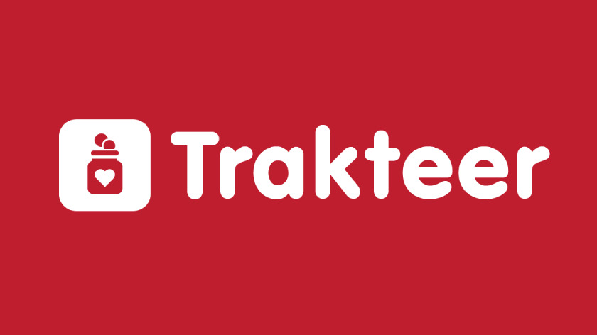

# 🕌 AmanahZIS — Aplikasi Manajemen Zakat & Fidyah

Platform operasional **open source** untuk panitia zakat (amil) di masjid dan organisasi keislaman.
Mengelola penerimaan zakat fitrah, zakat mal, dan fidyah — sampai perhitungan porsi, penyaluran ke
mustahik, laporan, dan papan informasi publik.

> 🆓 Gratis dan terbuka · 🚫 Dilarang diperjualbelikan · 🤝 Silakan dikembangkan bersama

---

## ✨ Fitur Utama

| Modul | Keterangan |
|---|---|
| 📊 **Dashboard** | Ringkasan penerimaan, progres penyaluran, aktivitas terbaru, dan status layanan |
| 🌾 **Zakat Fitrah** | Pencatatan beras maupun uang, per anggota keluarga atau per jumlah jiwa |
| 💰 **Zakat Mal** | Penghasilan, emas, dan perdagangan dengan acuan nisab per periode |
| 🍚 **Fidyah** | Pengganti puasa dalam bentuk uang atau makanan |
| 🧮 **Perhitungan** | Porsi amil (persentase tetap atau rasio × faktor), estimasi paket pembungkusan, kunci batch |
| 📦 **Pendistribusian** | Penyaluran per batch terkunci atau manual per kategori, plus penugasan pengiriman |
| 👥 **Data Master** | Muzakki beserta anggota keluarga, mustahik dengan rute distribusi, pengaturan asnaf |
| 📑 **Laporan** | Ekspor PDF dan Excel siap cetak |
| 📡 **Live Monitoring** | Papan publik `/tv` untuk layar masjid, tanpa perlu login |
| 🔐 **Hak Akses** | Peran super admin, ketua, sekretaris, bendahara, petugas, dan pengamat |
| 💾 **Cadangan & Reset** | Unduh seluruh data sebagai berkas `.sql`, dan reset data untuk memulai periode baru |

---

## 🧰 Teknologi

- **Next.js 16** (Pages Router) + **React 18** + **TypeScript**
- **Tailwind CSS** + **shadcn/ui**
- **Supabase** (PostgreSQL, Auth, Row Level Security, Realtime, Edge Functions)
- **TanStack Query**, **Recharts**, **jsPDF**, **SheetJS**

---

## 🚀 Panduan Pemasangan

Setiap pemasangan memakai **proyek Supabase miliknya sendiri**. Tidak ada kunci atau ID proyek
siapa pun di dalam repositori ini.

### Prasyarat

- **Node.js 20** atau lebih baru, beserta npm
- Akun **[Supabase](https://supabase.com)** (paket gratis sudah cukup)
- **Supabase CLI** — dipakai lewat `npx`, tidak perlu dipasang global

### 1. Clone dan pasang dependensi

```sh
git clone https://github.com/alpandi15/zis-zakat_system.git
cd zis-zakat_system
npm install
```

### 2. Buat proyek Supabase

1. Masuk ke [supabase.com/dashboard](https://supabase.com/dashboard) lalu **New project**.
2. Isi nama proyek, **simpan baik-baik database password** yang Anda buat — nanti dipakai saat
   menjalankan migrasi.
3. Pilih region terdekat, misalnya Singapore untuk pengguna di Indonesia.
4. Tunggu sampai proyek selesai disiapkan.

### 3. Siapkan berkas `.env`

Salin contoh yang tersedia:

```sh
cp .env.example .env
```

Lalu isi dari dashboard Supabase:

| Variabel | Lokasi di dashboard Supabase |
|---|---|
| `NEXT_PUBLIC_SUPABASE_URL` | **Project Settings → Data API → Project URL** |
| `NEXT_PUBLIC_SUPABASE_PUBLISHABLE_KEY` | **Project Settings → API Keys → publishable / anon key** |
| `NEXT_PUBLIC_MASJID_NAME` | Nama masjid Anda, tampil di kop laporan dan papan `/tv` |
| `NEXT_PUBLIC_MASJID_ADDRESS` | Alamat masjid Anda |

> ⚠️ Gunakan **publishable / anon key**, bukan `service_role`. Variabel berawalan `NEXT_PUBLIC_`
> ikut terkirim ke browser. Berkas `.env` sudah diabaikan Git sehingga tidak akan ter-commit.

### 4. Jalankan migrasi database

Ambil **project ref** Anda dari URL dashboard
(`https://supabase.com/dashboard/project/`**`<project-ref>`**), lalu:

```sh
npx supabase login
npx supabase link --project-ref <project-ref-anda>
npx supabase db push
```

Perintah terakhir akan meminta database password dari langkah 2. Seluruh tabel, kebijakan RLS,
fungsi, dan trigger akan terpasang.

### 5. Buat akun super admin pertama

Repositori ini **tidak memuat kredensial bawaan**. Pilih salah satu cara:

<details>
<summary><b>Cara A — lewat dashboard (disarankan)</b></summary>

1. Buka **Authentication → Users → Add user**, isi email dan password Anda sendiri,
   centang *Auto Confirm User*.
2. Buka **SQL Editor**, jalankan:

   ```sql
   insert into public.user_roles (user_id, role)
   select id, 'super_admin'::public.app_role
   from auth.users
   where email = 'email-anda@contoh.com'
   on conflict do nothing;
   ```

</details>

<details>
<summary><b>Cara B — lewat SQL Editor sekaligus</b></summary>

Jalankan di **SQL Editor**, ganti nilainya dengan milik Anda:

```sql
select set_config('zakatku.bootstrap_admin_email', 'email-anda@contoh.com', false);
select set_config('zakatku.bootstrap_admin_password', 'PasswordKuatAnda', false);
select set_config('zakatku.bootstrap_admin_name', 'Nama Anda', false);
```

Lalu salin isi `supabase/migrations/20260311143000_seed_bootstrap_super_admin.sql` ke editor yang
sama dan jalankan. Akun akan dibuat beserta peran `super_admin`.

</details>

### 6. Jalankan aplikasi

```sh
npm run dev
```

Buka [http://localhost:3000](http://localhost:3000) dan login dengan akun dari langkah 5.

### 7. Konfigurasi awal di dalam aplikasi

1. **Periode** → buat periode zakat (mis. *Ramadhan 1447 H*) dan isi acuan: beras per jiwa,
   uang per jiwa, tarif fidyah harian, serta harga emas untuk nisab.
2. **Pengaturan → Asnaf** → sesuaikan golongan penerima dan persentase amil.
3. **Mustahik** → masukkan data penerima beserta RT/gang dan nomor urut distribusi.
4. **Admin → Pengguna** → tambahkan akun panitia lain sesuai perannya.

---

## ☁️ Deploy ke Produksi

Aplikasi ini berjalan baik di Vercel, Netlify, atau VPS mana pun yang mendukung Next.js.

```sh
npm run build
npm run start
```

Daftarkan variabel lingkungan yang sama seperti pada `.env` di panel environment variables milik
penyedia hosting Anda.

---

## 💾 Cadangan & Pemulihan Data

Menu **Pengaturan → Cadangan & reset data** (khusus super admin) menyediakan:

- **Unduh Backup SQL** — seluruh isi tabel sebagai berkas `.sql` berisi perintah `INSERT`.
- **Reset Data** — mengosongkan data transaksi, atau sekaligus data master, dengan konfirmasi ganda.
  Akun login dan pengaturan asnaf tidak pernah ikut terhapus.

Memulihkan dari berkas cadangan: buka **SQL Editor**, tempel seluruh isi berkas `.sql`, jalankan.
Berkas memakai `ON CONFLICT DO NOTHING` sehingga aman dijalankan berulang kali.

---

## 🛠️ Operasional Migrasi Supabase

```sh
# Bandingkan migrasi lokal dengan remote
npx supabase migration list --linked

# Terapkan migrasi yang belum masuk
npx supabase db push

# Cadangan penuh sebelum tindakan berisiko
npx supabase db dump --linked -f backup_full.sql
npx supabase db dump --linked --role-only -f backup_roles.sql

# Batalkan satu migrasi terakhir di remote
npx supabase migration down --linked --last 1 --yes
```

> ⚠️ `npx supabase db reset --linked` **menghapus seluruh isi database remote**, termasuk akun
> pengguna. Selalu buat cadangan terlebih dahulu.

Bila aplikasi melaporkan tabel tidak ditemukan padahal migrasi sudah dijalankan, segarkan cache
PostgREST lewat SQL Editor:

```sql
notify pgrst, 'reload schema';
```

---

## 📸 Tampilan Aplikasi

### 🏠 Dashboard


### ➕ Input Zakat Fitrah


### 🧾 Data Muzakki / Fitrah


### 🍚 Fidyah


### 👥 Data Mustahik


### 🧮 Perhitungan Zakat


### 📅 Periode Zakat


### 📡 Live Monitoring


---

## ⚠️ Ketentuan Penggunaan

Aplikasi ini **gratis dan open source**, dibuat khusus untuk kebutuhan masjid dan organisasi zakat.

**Diperbolehkan:**
- Dipakai untuk operasional masjid, panitia zakat (amil), dan organisasi sosial keislaman
- Dimodifikasi sesuai kebutuhan lembaga
- Dikembangkan dan dikontribusikan kembali

**Tidak diperbolehkan:**
- 🚫 Digunakan untuk tujuan komersial
- 🚫 Diperjualbelikan dalam bentuk apa pun

Aplikasi disediakan apa adanya tanpa jaminan. Keakuratan perhitungan dan kesesuaiannya dengan
ketentuan syariat tetap menjadi tanggung jawab panitia yang menggunakan. Mohon diverifikasi
bersama pembina atau ustadz setempat.

---

## 🤝 Kontribusi

Kontribusi sangat terbuka — perbaikan bug, fitur baru, maupun penyempurnaan dokumentasi.

1. Fork repositori ini
2. Buat branch fitur: `git checkout -b fitur/nama-fitur`
3. Pastikan lolos pemeriksaan: `npm run lint` dan `npm run build`
4. Commit, push, lalu buka Pull Request

Menemukan masalah atau punya usulan? Silakan buka **Issue**.

---

## ☕ Dukung Pengembangan

Aplikasi ini dikerjakan di waktu luang dan dibagikan gratis untuk masjid mana pun yang
membutuhkan. Bila bermanfaat dan ingin memberi dukungan:

<table align="center">
  <tr>
    <td align="center" width="260">
      <a href="https://teer.id/alpandi15_">
        
      </a>
    </td>
    <td align="center" width="260">
      <a href="https://saweria.co/alpandi15">
        
      </a>
    </td>
  </tr>
  <tr>
    <td align="center">
      <a href="https://teer.id/alpandi15_"><b>teer.id/alpandi15_</b></a>
    </td>
    <td align="center">
      <a href="https://saweria.co/alpandi15"><b>saweria.co/alpandi15</b></a>
    </td>
  </tr>
</table>

Dukungan sekecil apa pun sangat membantu untuk menjaga aplikasi ini tetap dikembangkan.
Yang tidak bisa berdonasi pun tetap dipersilakan memakainya sepenuhnya, gratis. 🙏

---

<p align="center">
  Semoga menjadi amal jariyah bagi kita semua. <b>Aamiin.</b>
</p>
